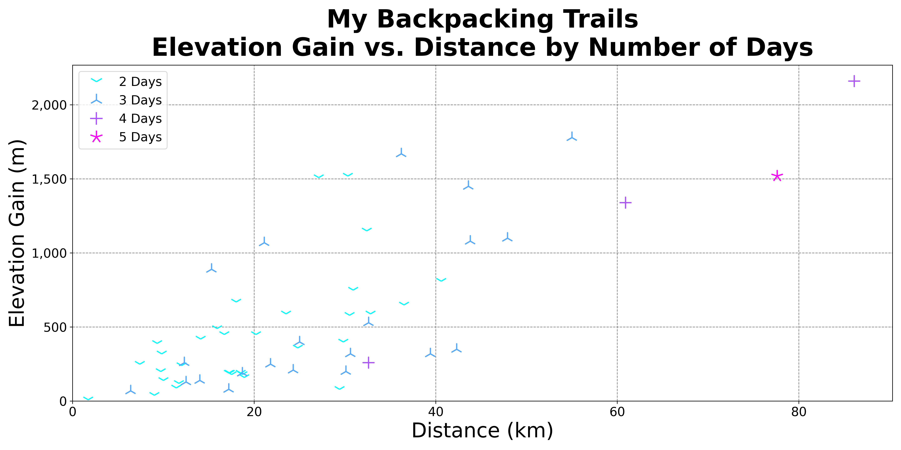
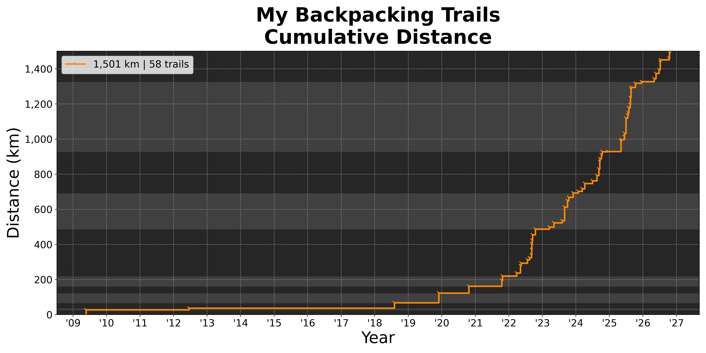
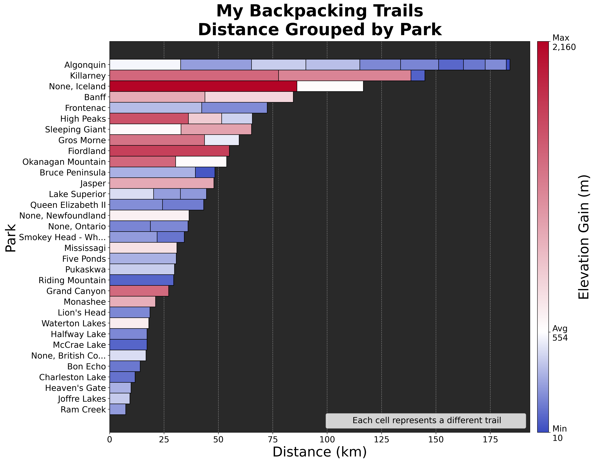
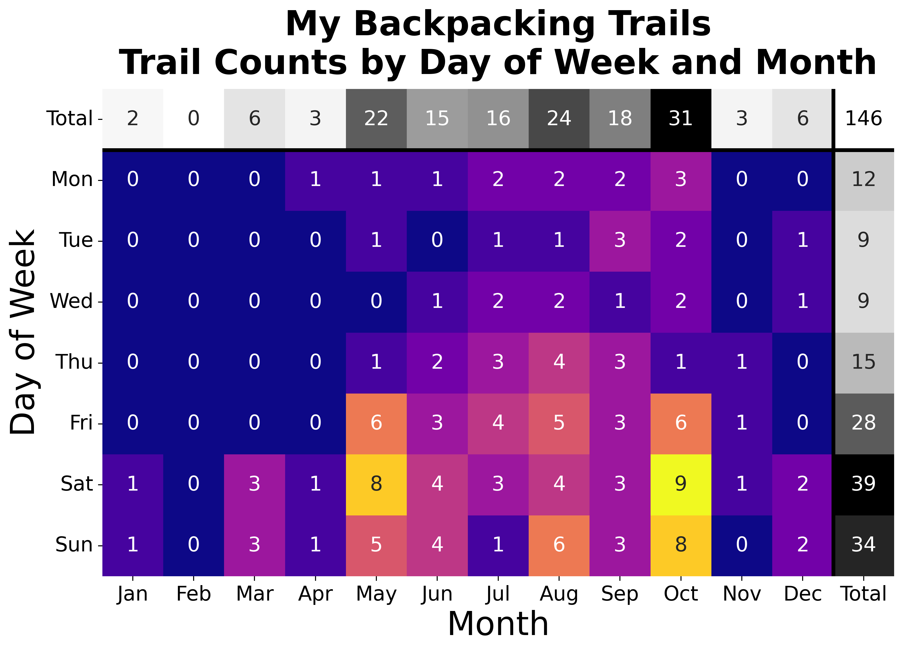
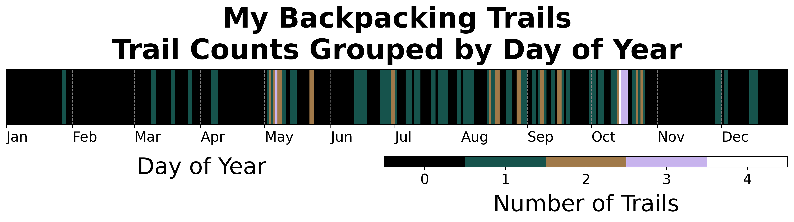
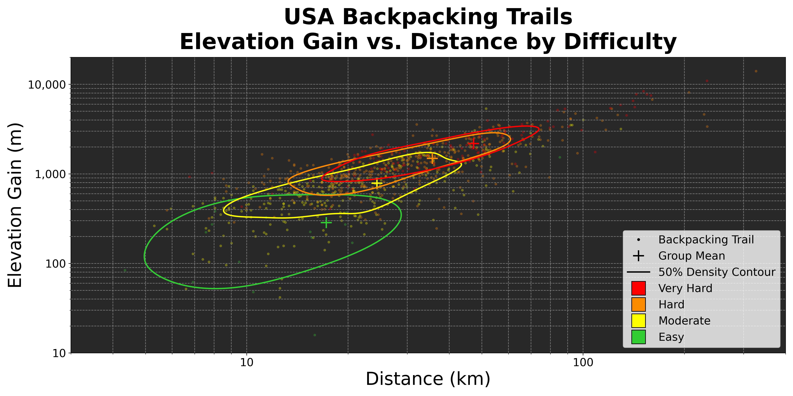
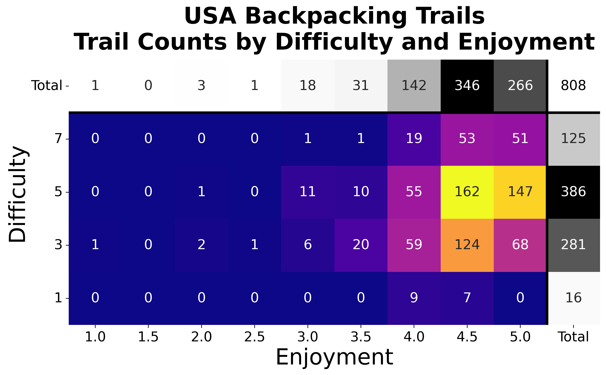
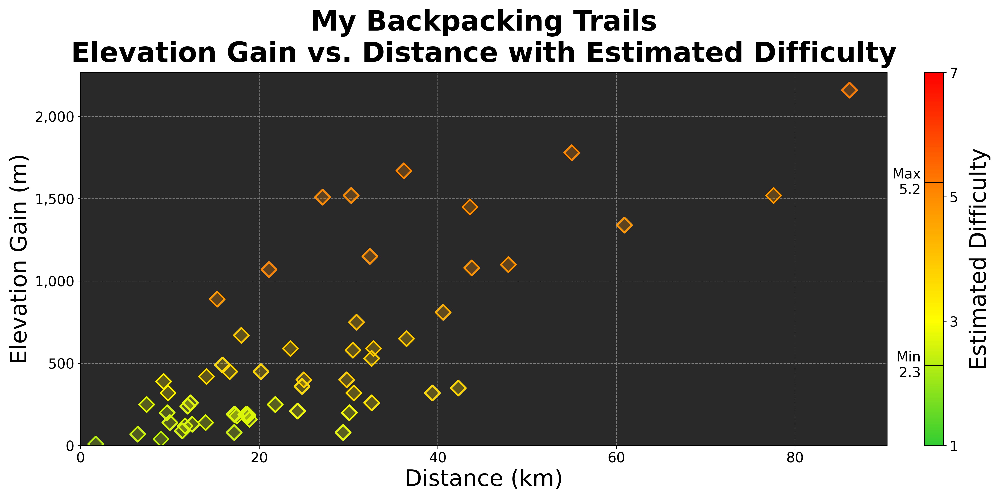

# MyTrails

MyTrails is a project exploring my personal backpacking statistics, featuring a supervised learning experiment to test whether a trail's distance and elevation gain are good predictors of its difficulty and enjoyment.

## Data

- **`data/MyTrails.csv`**
    - My 58 completed backpacking trails
- **`data/alltrails-data.csv`**
    - All 3,195 trails in USA national parks, a Kaggle dataset (no longer available) originally scraped from AllTrails
    - Filtered down to 808 backpacking trails for training since I am only interested in backpacking trails

## Plots










## Machine Learning

**Features:**
- Distance (km)
- Elevation Gain (m)

**Targets:**
- Difficulty (1-7 scale)
- Enjoyment (1-5 scale)

Multicollinearity is considered. Distance and elevation gain have a correlation of 0.87 and a VIF of 3.99, comfortably under the standard threshold of 5–10.

Feature scaling is not needed since none of the candidate models are sensitive to feature magnitude.

For both difficulty and enjoyment, the same procedure is run:

1. **Data Stratification**

    Before splitting the data into an 80% training set and a 20% test set, every trail is assigned to a bin based on its target value. Difficulty has enough trails at each category to stratify on those values directly. However, some low enjoyment categories have very few trails, so its bins are quantile-based to have a similar number of trails rather than the same range.
        
    | Difficulty | Train | Test |
    |:---:|:---:|:---:|
    | 1 | 13 | 3 |
    | 3 | 225 | 56 |
    | 5 | 308 | 78 |
    | 7 | 100 | 25 |
    | **Total** | **646** | **162** |
        
    | Enjoyment | Train | Test |
    |:---:|:---:|:---:|
    | 1–4 | 157 | 39 |
    | 4.5 | 276 | 70 |
    | 5 | 213 | 53 |
    | **Total** | **646** | **162** |

2. **Cross Validation**

    The training data is further divided into 5 folds, built the same stratified way, and every candidate model below is compared on the same folds. The candidate models are:
    - A baseline that predicts the mean
    - Linear regression
    - Random forest
    - Gradient boosting

    The candidates are either highly interpretable, like linear regression, or report a feature importance directly, like random forest and gradient boosting. The random forest and gradient boosting models are each tuned with a grid search.

3. **Model Selection**

    The candidate with the lowest cross-validated RMSE is selected and used to get the final test RMSE and R².

## Results

### Difficulty

| | Baseline | Linear Regression | Random Forest | Gradient Boosting |
|---|---|---|---|---|
| CV RMSE | 1.455 | 1.334 | 1.223 | 1.224 |
| Train R² | 0.000 | 0.171 | 0.360 | 0.377 |

**Best Model:** Random Forest (test RMSE: 1.141, test R²: 0.377)

**Feature Importance:** Distance: 0.07, Elevation Gain: 0.93

**Verdict:** Distance and (especially) elevation gain are good predictors of trail difficulty.

### Enjoyment

| | Baseline | Linear Regression | Random Forest | Gradient Boosting |
|---|---|---|---|---|
| CV RMSE | 0.501 | 0.496 | 0.491 | 0.491 |
| Train R² | 0.000 | 0.036 | 0.138 | 0.118 |

**Best Model:** Random Forest (Test RMSE: 0.550, Test R²: -0.056)

**Feature Importance:** Distance: 0.35, Elevation Gain: 0.65

**Verdict:** Distance and elevation gain are terrible predictors of trail enjoyment.

## Project Structure

```
MyTrails/
├── MyTrails.ipynb         # Clean & explore the data, train models, predict, visualize
├── data/
│   ├── MyTrails.csv       # My own completed backpacking trails
│   └── alltrails-data.csv # USA national park trail dataset (AllTrails)
├── images/                # Generated plots
└── README.md
```
